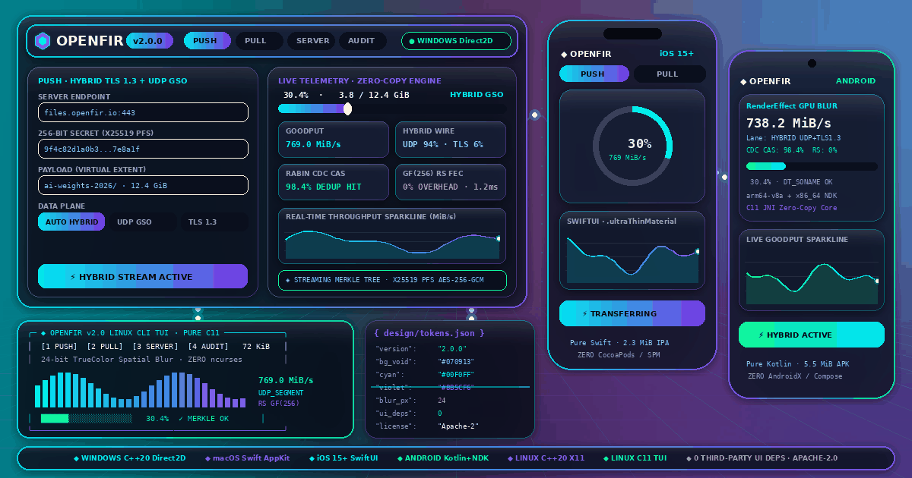

<div align="center">

# ◆ OpenFIR `v2.0.0`

### **Zero-Dependency High-BDP Hybrid File Transfer Engine & All-Platform Native Frosted-Glass Suite**
*Obsidian Frost × Neon Aurora · Built From Scratch in Each Platform's Peak-Performance Native Language*

[](https://github.com/openfir/openfir/releases/tag/v2.0.0)
[](LICENSE)
[](#clean-room-provenance-ip-purity--legal-compliance)
[](https://doi.org/10.5281/zenodo.24297603)

<br/>



*Generated directly from [`design/tokens.json`](design/tokens.json) — unified **Obsidian Frost × Neon Aurora** glassmorphism running natively across Windows, macOS, iOS, Android, Linux Desktop, and Linux Terminal with **0 third-party UI frameworks**.*

</div>

---

## Why OpenFIR `v2.0.0`?

**OpenFIR** (**Open** **F**ast **I**nterleaved **R**eliable Transport Protocol) unites an enterprise-grade, bidirectional (`push` & `pull`) high-BDP file & directory transport engine with a **six-platform native frosted-glass client ecosystem**—every single pixel, Gaussian blur pass, sparkline, and widget engineered from scratch in each OS's fastest native language with **zero third-party UI libraries** (no Electron, no Qt, no GTK, no `ncurses`, no AndroidX/Compose, no CocoaPods/SPM).

| Pillar | What `v2.0.0` Delivers |
| :--- | :--- |
| **Hybrid Anti-QoS Wire Engine (`openfir/1`)** | Single-port dual-stack (`:443` / `:9900`) combining **RFC 8446 TLS 1.3** (`ALPN: openfir/1`) + transparent **`OF1\x01`** UDP acceleration (`UDP_SEGMENT` GSO, `UDP_GRO`, `SO_REUSEPORT`). Sub-second automatic failover when ISPs throttle or blackhole UDP. |
| **0%-Overhead Cauchy GF(256) RS FEC** | Clean-room systematic Reed-Solomon over GF(256): **strictly 0% parity overhead on lossless links**, instant multi-packet burst-loss recovery on lossy transcontinental / satellite links. |
| **Shift-Resistant Rabin CDC CAS + Merkle** | 0 ms cold-start 1981 Rabin polynomial chunking (>98% reuse even after 1-byte prepends), exact 0%-FP interactive TLS CAS, tarless `VirtualDirectoryExtent`, crash-resumable `.openfir-part`/`.openfir-state`, and streaming **BLAKE2b-256 Binary Merkle** proof. |
| **6 Peak-Performance Native Frosted-Glass Clients** | **Pure C11 Linux CLI TUI** (`72 KiB`), **Pure C++20 Linux X11 Gaussian-Blur GUI** (`122 KiB`), **Pure C++20 Windows Direct2D/DWM Acrylic**, **Pure Swift macOS AppKit Vibrancy**, **Pure Swift iOS 15+ Material**, and **Pure Kotlin Android RenderEffect** — all linked in-process to [`include/openfir.h`](include/openfir.h). |
| **Extreme Legal & Supply-Chain Purity** | **100% Apache-2.0 clean-room code**. **Zero** third-party GitHub/Maven/CocoaPods/npm dependencies anywhere. Links exclusively to OS system SDKs + Go stdlib + official `golang.org/x/{crypto,sys}`. |

---

## All-Platform Native Clients (*Obsidian Frost × Neon Aurora*)

All six clients implement the exact same design system ([`design/tokens.json`](design/tokens.json) & [`design/DESIGN_SYSTEM.md`](design/DESIGN_SYSTEM.md)) — **`PUSH` · `PULL` · `SERVER` · `AUDIT`**, live 20 Hz telemetry, 60-sample real-time throughput sparklines, 4 frosted KPI tiles, 1-click 256-bit Keygen, and cryptographic Merkle Root verification:

| Platform | Release Asset | Native Language & Graphics Stack | Frosted-Glass Engine | Binary / Pkg Size | Third-Party UI Deps |
| :--- | :--- | :--- | :--- | :---: | :---: |
| **Linux CLI (TUI)** | `openfir-desktop-tui_v2.0.0_linux_{amd64,arm64}.tar.gz` | **Pure C11** (`termios`, `ioctl`, SGR 1006 mouse, DEC 2026 sync) | 24-bit TrueColor spatial-blur alpha-blended glass cards + 2×4 Unicode Braille (`⠀..⣿`) sparkline over live aurora | **72 KiB** (`openfir-tui`) | **0** *(no `ncurses`)* |
| **Linux Desktop** | `openfir-desktop-tui_v2.0.0_linux_{amd64,arm64}.tar.gz` | **Pure C++20** + raw **X11 (`libX11`) + `libXft`** | From-scratch ARGB32 2-pass separable Gaussian-blur frosted glass compositor + SDF neon geometry | **122 KiB** (`openfir-gui`) | **0** *(no GTK/Qt/Cairo/Electron)* |
| **Windows x64** | `openfir-gui_v2.0.0_windows_amd64.zip` | **Pure C++20** + **Win32 + Direct2D + DirectWrite + DWM** | Native **Windows 11 DWM Acrylic** (`DWMWA_SYSTEMBACKDROP_TYPE`) + GPU Direct2D radial aurora & Bezier sparklines | **2.6 MiB** *(GUI + DLL + CLI)* | **0** *(Win32 SDK only)* |
| **macOS 13+** | `openfir-gui_v2.0.0_macos_universal.zip` | **Pure Swift** + **AppKit (`NSVisualEffectView`) + SwiftUI** | Native macOS `.hudWindow` system vibrancy over animated `Canvas` aurora + native `NSOpenPanel` | **2.4 MiB** (`OpenFIR.app`) | **0** *(Apple SDK only)* |
| **iOS 15.0–26+** | `openfir-gui_v2.0.0_ios_arm64_unsigned.ipa` | **Pure Swift** + **SwiftUI + UIKit (`.ultraThinMaterial`)** | Native iOS ultra-thin frosted glass material + Files `fileImporter` integration (TrollStore / Xcode signable) | **2.3 MiB** (`.ipa`) | **0** *(Apple SDK only)* |
| **Android 8–15+** | `openfir-gui_v2.0.0_android_universal.apk` | **Pure Kotlin** + **Android Platform SDK + C11 JNI** | Native Android 12+ GPU **`RenderEffect.createBlurEffect`** + hardware-accelerated `Canvas` glass + SAF picker | **5.5 MiB** (`arm64`+`x64` `.apk`) | **0** *(no AndroidX/Material/Compose)* |
| **Pure CLI Engine** | `openfir_v2.0.0_{linux,windows,darwin}_{amd64,arm64}` | **Pure Go 1.26** (`CGO_ENABLED=0` static binary) | Headless server & high-BDP scripting CLI (`server` / `push` / `pull` / `keygen` / `selftest`) | **~2.5 MiB** | **0** *(Go stdlib + `x/crypto,x/sys`)* |

---

## Core Architecture

```text
+------------------------------------------------------------------------------------+
|                          OpenFIR v2.0 NATIVE CLIENT LAYER                          |
|  [Win C++20 D2D] [macOS AppKit] [iOS SwiftUI] [Android Kotlin] [X11 GUI] [C11 TUI] |
+-----------------------------------------|------------------------------------------+
                                          | In-Process Zero-Copy C ABI (include/openfir.h)
                                          v 20 Hz Lock-Free Telemetry + Async Control
+------------------------------------------------------------------------------------+
|                              OpenFIR v2.0 CORE ENGINE                              |
|                                                                                    |
|  [File OR Directory Tree] -> [VirtualDirectoryExtent (O(log N), 64-FD LRU)]        |
|                                        |                                           |
|                                        v                                           |
|      [0ms Cold-Start 1981 Rabin Polynomial CDC (48B Window, BLAKE2b-256)]          |
|                     |                                     |                        |
|        (Streaming Merkle Tree)           (Interactive TLS 1.3 CAS / Resume Query)  |
|                                               /           |            \           |
|                                    (CAS/Resume Hit)  (All-Zero)     (New Block)    |
|                                          |                |              v         |
|                                      [0 Wire B]    [MsgZeroBlock] [4KB Entropy-    |
|                                                                    Gated DEFLATE]  |
|                                                                          |         |
|                                       [Hybrid Anti-QoS Path Scheduler] <-+         |
|                                        /                            \              |
|               (Healthy High-BDP Link) /                              \ (Fallback / |
|                                      v                                v Parallel)  |
|        [Clean-Room Cauchy GF(256) RS (0% loss = 0 parity)]   [K Parallel TLS 1.3   |
|         -> [Delay-Gradient & CAR-Safe MicroPacer (<=256KB)]   TCP Data Lanes]      |
|         -> [OF1\x01 17B AAD + X25519-PFS AES-256-GCM]                |             |
|         -> [Linux UDP_SEGMENT GSO Batch Writer]                      |             |
+--------------------------------------|-------------------------------|-------------+
                                       | Single Port (:443 / :9900)    |
                    UDP (OF1\x01)      v                               v  TCP (TLS 1.3 ALPN openfir/1)
+--------------------------------------|-------------------------------|-------------+
|                              OpenFIR v2.0 RECEIVER                   |             |
|                                      |                               |             |
|   [Linux UDP_GRO ReadBatchGRO + 16,384-Pkt Replay Window]            |             |
|    -> [Cauchy GF(256) RS Decoder + Normalized Kalman OWDG]           |             |
|                                       \                             /              |
|                                        v                           v               |
|           [BLAKE2b-256 Block Verify + Persistent .openfir-part/.openfir-state]     |
|                                        |                                           |
|                                        v                                           |
|       [Streaming Binary Merkle Root Verify -> fsync -> Atomic Commit / Unpack]     |
+------------------------------------------------------------------------------------+
```

---

## Quick Start

### 1. Pre-Built Binaries & Native Apps (Recommended)
Download ready-to-run CLI archives and native frosted-glass apps from **[GitHub Releases `v2.0.0`](https://github.com/openfir/openfir/releases/tag/v2.0.0)** and verify integrity against `SHA256SUMS.txt`.

### 2. Run CLI Server, Push, Pull & 4-Suite Self-Test
```bash
# Install standalone Go CLI directly
go install github.com/openfir/openfir/cmd/openfir@v2.0.0

# 1. Run built-in 4-suite enterprise verification (Hybrid, CDC CAS, 10% Loss FEC, UDP Blackhole Failover)
openfir -mode selftest

# 2. Generate a 256-bit shared secret
export OPENFIR_SECRET=$(openfir -mode keygen)

# 3. Start Single-Port Dual-Stack Server (TLS 1.3 TCP + UDP on :443 or :9900)
openfir -mode server -listen :443 -dir ./openfir_data -secret "$OPENFIR_SECRET" \
  -tls-cert /etc/ssl/fullchain.pem -tls-key /etc/ssl/privkey.pem

# 4. Push a file OR entire nested directory tree (Hybrid Auto: UDP GSO/FEC + TLS 1.3 TCP)
openfir -mode push -server files.example.com:443 -verify-ca \
  -file ./large_dataset -secret "$OPENFIR_SECRET"

# 5. Pull back with crash-resumable staging & Merkle proof
openfir -mode pull -server files.example.com:443 -verify-ca \
  -file large_dataset -dir ./downloads -secret "$OPENFIR_SECRET"
```

### 3. Build Native Frosted-Glass Clients From Source
```bash
# Linux Core C-ABI Library + C11 TrueColor TUI (0 ncurses) + C++20 X11 Gaussian-Blur GUI (0 GTK/Qt)
CGO_ENABLED=1 go build -trimpath -buildmode=c-shared \
  -ldflags="-s -w -extldflags=-Wl,-soname,libopenfir_core.so" \
  -o dist/libopenfir_core.so ./cmd/openfir-cabi
make -C apps/linux-tui test   # Builds & smoke-tests dist/openfir-tui
make -C apps/linux-gui test   # Builds & smoke-tests dist/openfir-gui

# Windows x64 (PowerShell with MSVC + Go + MinGW GCC)
.\apps\windows\build_windows.ps1

# Apple macOS 13+ (.app) & iOS 15+ (.ipa) (Xcode + XcodeGen)
./scripts/build_apple_core.sh && (cd apps/apple && xcodegen generate)

# Android 8–15+ (.apk, Zero AndroidX)
./scripts/build_android_core.sh && gradle --no-daemon -p apps/android assembleDebug
```

---

## Command-Line Flags (`openfir`)

| Flag | Default | Description |
| :--- | :--- | :--- |
| `-mode` | `""` | Execution mode: `server`, `push`, `pull`, `keygen`, or `selftest` |
| `-listen` | `:9900` | Single-port dual-stack (TLS 1.3 TCP + UDP) server listen address (e.g., `:443`) |
| `-server` | `127.0.0.1:9900` | Target server address for `push` / `pull` |
| `-sni` | *(host from `-server`)* | Optional TLS 1.3 SNI hostname |
| `-verify-ca` | `false` | Enforce system/public CA certificate verification (recommended with `-tls-cert`) |
| `-tls-cert` / `-tls-key` | `""` | Server TLS 1.3 certificate & private key PEM paths (auto-generates ephemeral ECDSA P-256 cert if omitted) |
| `-dir` | `./openfir_data` | Server root directory (`server`) OR local output directory (`pull`) |
| `-file` | `""` | Local file/directory path (`push`) OR remote file/directory name (`pull`) |
| `-name` | *(basename of `-file`)* | Optional remote filename override for `push` |
| `-secret` | `$OPENFIR_SECRET` | Shared secret: 64-char hex (256-bit) or `pass:<passphrase>` (Argon2id 32 MiB) |
| `-transport` | `auto` | Data-plane mode: `auto` (Hybrid UDP + TLS 1.3 TCP), `udp`, or `tcp` |
| `-tcp-streams` | `4` | Parallel TLS 1.3 TCP data lanes for `auto` / `tcp` modes |
| `-init-mbps` | `4.0` | Initial slow-start pacing rate in MiB/s |
| `-max-mbps` | `1000.0` | Maximum pacing rate ceiling in MiB/s |
| `-max-parity` | `8` | Max Cauchy GF(256) RS parity shards per 16-shard group (0% loss = strictly 0 parity) |
| `-overwrite` | `false` | Allow overwriting existing destination files or directories |
| `-max-file-gb` | `256` | Maximum allowed transfer size in GB on server |
| `-max-sessions` | `64` | Maximum concurrent active sessions on server |

---

## Open Wire Specification (`openfir/1`)

OpenFIR uses strictly transparent, Wireshark- and enterprise-firewall-friendly framing with **zero protocol spoofing or port-hopping obfuscation** (100% wire-compatible between `v1.0.0` and `v2.0.0`):

1. **Control & Parallel TCP Data Lanes**: Standard **RFC 8446 TLS 1.3** over TCP advertising **`ALPN: openfir/1`**, authenticated mutually via **RFC 5705 `ExportKeyingMaterial`** (`EXPORTER-OpenFIR-v1-ChannelBind`), cryptographically binding the shared secret to the live TLS 1.3 handshake.
2. **UDP Data Lane** (33 bytes total overhead: 17-byte cleartext AAD header + 16-byte AES-256-GCM tag):
   ```text
   +-------------------+-----------+---------------+------------------+------------------------+
   | Magic "OF1\x01"   | Flags(1B) | SessionID(4B) | MonotonicSeq(8B) | AES-256-GCM Cipher+Tag |
   +-------------------+-----------+---------------+------------------+------------------------+
   |<----------------------------- 17-Byte AAD ----------------------->|
   ```
   * Per-session directional `c2s`/`s2c` AES-256-GCM keys and 4-byte nonce salts are derived from `HKDF-SHA256(MasterKey || EphemeralX25519SharedSecret, SessionID)`.
   * Nonce is `DirSalt(4B) || MonotonicSeq(8B)`; inbound packets pass a **16,384-packet sliding anti-replay bitmap**.

---

## Clean-Room Provenance, IP Purity & Legal Compliance

### 1. Patent-Free & Public-Domain Algorithm Provenance
Every core protocol mechanism and every native user interface in OpenFIR v2.0 was clean-room implemented from scratch to eliminate third-party patent encumbrances, supply-chain risk, and copyleft obligations:

| Component | Algorithm / Standard | Origin & Public-Domain / Open-Standard Basis |
| :--- | :--- | :--- |
| **Control & TCP Transport** | TLS 1.3 (`ALPN: openfir/1`) & Channel Binding | IETF RFC 8446 & RFC 5705 (Go stdlib `crypto/tls`) |
| **AEAD & Forward Secrecy** | AES-256-GCM & X25519 ECDH | NIST SP 800-38D & IETF RFC 7748 (Go stdlib `crypto/aes`, `crypto/cipher`, `crypto/ecdh`) |
| **Password KDF & Block Hash** | Argon2id & BLAKE2b-256 | IETF RFC 9106 & RFC 7693 — **CC0 Public Domain** (`golang.org/x/crypto`, BSD-3-Clause + Google `PATENTS` grant) |
| **Content-Defined Chunking** | Classic Rabin Polynomial Rolling Fingerprint (48B window) | Michael O. Rabin (1981) & LBFS single-mask CDC (2001) — >25-year public-domain prior art; original polynomial `0x003614c8012bce63` |
| **End-to-End Integrity** | Binary Merkle Tree over BLAKE2b-256 | Ralph Merkle (1979, patent expired 2002) — clean-room Go implementation |
| **Forward Error Correction** | Systematic Cauchy GF(256) Reed-Solomon (`0x11D`) | Reed & Solomon (1960) & Blomer et al. Cauchy construction (1995) — >30-year textbook math, clean-room Go |
| **Adaptive Compression** | Entropy-Gated RFC 1951 DEFLATE (`BestSpeed`) | IETF RFC 1951 (1993) — >30-year public-domain standard (Go stdlib `compress/flate`) |
| **Congestion Control** | Delay-Gradient & Delivery-Rate CC | RFC 5681 slow start, RFC 6298 SRTT, Kalman filter (1960), and token-bucket pacing — clean-room Go |
| **6 Native Frosted-Glass UIs** | C11 ANSI/termios, C++20 X11/Direct2D, Swift AppKit/SwiftUI, Kotlin Platform SDK | **100% original Apache-2.0 clean-room UI code** — strictly zero third-party UI libraries |

### 2. Defensive Publication, Dependency Attribution & Export Notice
- **Defensive Publication**: This repository and its Zenodo DOI releases ([`10.5281/zenodo.24297603`](https://doi.org/10.5281/zenodo.24297603)) serve as an open technical reference and prior-art publication under Apache-2.0.
- **Zero Third-Party Dependencies**: Compiled binaries link exclusively against operating-system platform SDKs, the Go Standard Library, and official `golang.org/x/crypto` and `golang.org/x/sys` modules. Verbatim notices are maintained in [`THIRD_PARTY_LICENSES.md`](THIRD_PARTY_LICENSES.md) and bundled in every official release archive alongside [`LICENSE`](LICENSE) and [`NOTICE`](NOTICE).
- **Cryptography & Export Control**: Standard open-source cryptographic primitives (`TLS 1.3`, `AES-256-GCM`, `X25519`, `ECDSA P-256`, `HMAC-SHA256`, `Argon2id`, `BLAKE2b-256`) publicly available under License Exception **TSU / EAR § 742.15(b)**.
- **Trademark & Warranty Disclaimer**: OS and tool names (Windows, macOS, iOS, Android, Linux, Wireshark) are used strictly for compatibility reference. Provided **"AS IS"** per Sections 7–8 of Apache-2.0.

---

## License

Copyright (c) 2026 The OpenFIR Authors (`openfir`). Licensed under the **Apache License, Version 2.0**. See [`LICENSE`](LICENSE), [`NOTICE`](NOTICE), and [`THIRD_PARTY_LICENSES.md`](THIRD_PARTY_LICENSES.md).
