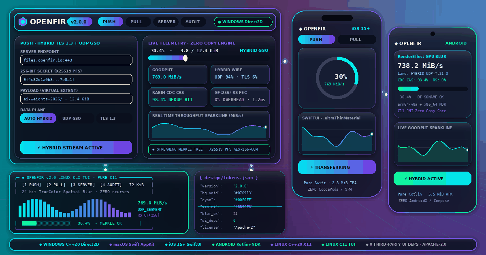

# ◆ OpenFIR `v2.0.0` — The All-Platform *Obsidian Frost* Release

**High-BDP Hybrid TLS 1.3 + UDP GSO/FEC Transport Engine × 6 Zero-Dependency Native Frosted-Glass Clients**

---

## 🚀 What's New in `v2.0.0` / 核心升级亮点

**OpenFIR `v2.0.0`** brings the rock-solid **`openfir/1`** wire-compatible transport core (100% interoperable with `v1.0.0`) together with an unprecedented **6-platform native frosted-glass GUI & Linux CLI TUI suite**, engineered from scratch in **each operating system's peak-performance native language** with **ZERO third-party UI libraries**.

**OpenFIR `v2.0.0`** 在保持与 `v1.0.0` 协议线缆 100% 互通的基础上，重磅推出**全平台 6 端原生毛玻璃现代 Web3 图形客户端套件（含 Linux 终端类图形 TUI）**——每一端均采用该平台最极致性能的顶级原生语言从 0 编写，**零 Electron、零 Qt、零 GTK、零 `ncurses`、零 AndroidX/Compose、零 CocoaPods/SPM**，在体积、启动速度、内存占用与开源法律合规纯净度上全部拉满！

### ✨ Unified *Obsidian Frost × Neon Aurora* Experience Across All 6 Platforms
Every native client shares the exact same visual language ([`design/tokens.json`](https://github.com/openfir/openfir/blob/v2.0.0/design/tokens.json)) and connects **in-process** to the zero-copy OpenFIR C ABI core (`include/openfir.h`) with **20 Hz lock-free telemetry**:
- **4 Unified Modes**: **`PUSH`** (Upload File/Directory) · **`PULL`** (Bidirectional Download) · **`SERVER`** (Single-Port Dual-Stack TLS 1.3 + UDP) · **`AUDIT`** (Built-in 4-Suite Cryptographic & Blackhole Failover Self-Test).
- **Live Glass Telemetry Deck**: Smooth neon gradient progress bar, 60-sample real-time throughput sparkline chart, 4 frosted KPI micro-tiles (`Goodput MiB/s`, `Hybrid UDP vs TLS 1.3`, `Rabin CDC CAS / Zero / Deflate`, `GF(256) RS FEC & RTT`), 1-click 256-bit `KEYGEN`, and live emerald **`✓ MERKLE VERIFIED`** proof strip.

---

## 📦 Complete `v2.0.0` Release Assets / 全平台下载清单

### 1. Native Frosted-Glass GUI & Linux TUI Clients (Zero Third-Party UI Deps!)

| Platform | Download Asset | Native Stack & Frosted-Glass Engine | Highlights |
| :--- | :--- | :--- | :--- |
| **Linux x86_64 (GUI + TUI + CLI)** | `openfir-desktop-tui_v2.0.0_linux_amd64.tar.gz` | **Pure C11 `openfir-tui` (72 KiB)** + **Pure C++20 X11/Xft `openfir-gui` (122 KiB)** + `libopenfir_core.so` + `openfir` | TUI: 24-bit TrueColor spatial blur + 2×4 Unicode Braille sparklines + SGR 1006 mouse (0 `ncurses`); GUI: From-scratch ARGB32 2-pass Gaussian blur compositor (0 GTK/Qt) |
| **Linux ARM64 (GUI + TUI + CLI)** | `openfir-desktop-tui_v2.0.0_linux_arm64.tar.gz` | Native ARM64 C11 TUI + C++20 X11 GUI + `libopenfir_core.so` + `openfir` | Ready for ARM64 workstations, Raspberry Pi, & AWS Graviton |
| **Windows x86_64** | `openfir-gui_v2.0.0_windows_amd64.zip` | **Pure C++20 Win32 + Direct2D + DirectWrite + DWM Acrylic** (`OpenFIR.exe` + `openfir_core.dll` + `openfir.exe`) | Native **Windows 11 DWM Acrylic** backdrop, GPU Direct2D radial aurora & sparklines, native Win32 file/folder pickers |
| **macOS 13+ (Universal)** | `openfir-gui_v2.0.0_macos_universal.zip` | **Pure Swift + AppKit `NSVisualEffectView` + SwiftUI** (`OpenFIR.app`) | Universal Apple Silicon (`arm64`) + Intel (`x86_64`), native `.hudWindow` vibrancy frosted glass, `NSOpenPanel` |
| **iOS 15.0–26+ (`arm64`)** | `openfir-gui_v2.0.0_ios_arm64_unsigned.ipa` | **Pure Swift + SwiftUI `.ultraThinMaterial`** (`OpenFIR.app` IPA) | Ultra-lean 2.3 MiB IPA, native Files integration (`fileImporter`), supports TrollStore or Xcode/self-signing |
| **Apple Universal Core SDK** | `OpenFIRCore_v2.0.0.xcframework.zip` | Universal macOS + iOS `arm64` static archive + `openfir.h` | Drop-in XCFramework for custom Xcode builds |
| **Android 8–15+ (`arm64`+`x64`)** | `openfir-gui_v2.0.0_android_universal.apk` | **Pure Kotlin (Platform SDK Only) + C11 JNI** (`OpenFIR-Android.apk`) | Android 12+ GPU **`RenderEffect.createBlurEffect`** frosted glass, SAF file picker, `DT_SONAME` verified, **ZERO AndroidX / Material / Compose** — ready to install directly! |

### 2. Standalone Pure-Go Headless CLI Binaries (`CGO_ENABLED=0`)
All classic single-binary CLI archives (`server` / `push` / `pull` / `keygen` / `selftest`) are included for servers, CI pipelines, and automation:
- `openfir_v2.0.0_linux_amd64.tar.gz` / `openfir_v2.0.0_linux_arm64.tar.gz`
- `openfir_v2.0.0_windows_amd64.zip` / `openfir_v2.0.0_windows_arm64.zip`
- `openfir_v2.0.0_darwin_amd64.tar.gz` / `openfir_v2.0.0_darwin_arm64.tar.gz`
- **`SHA256SUMS.txt`** — unified cryptographic checksum manifest covering every single CLI, GUI, TUI, and mobile asset.

---

## 🛡️ Legal & Supply-Chain Integrity Attestation
- **License**: **Apache License 2.0** (full `LICENSE`, `NOTICE`, and `THIRD_PARTY_LICENSES.md` bundled inside every archive).
- **Zero Third-Party Dependencies**: `go.mod` links exclusively to the Go Standard Library + official `golang.org/x/crypto` & `golang.org/x/sys`; all 6 native UIs link exclusively to OS platform SDKs.
- **Automated CI Verification**: Verified with `go test -race`, `clang -Wall -Wextra -Werror include/openfir.h`, live 4-suite end-to-end smoke tests inside Linux x64/ARM64 `openfir-tui`, Linux x64/ARM64 `openfir-gui`, and Windows x64 `OpenFIR.exe`, plus `readelf -d` `DT_SONAME`/`DT_NEEDED` audit inside `OpenFIR-Android.apk`.
